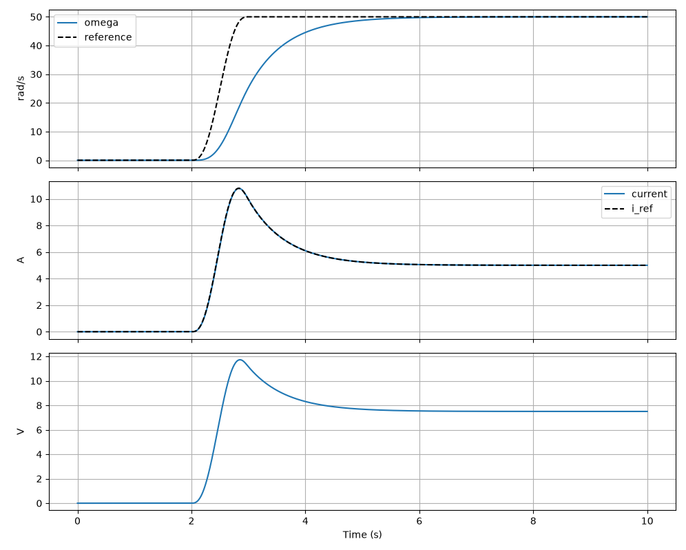
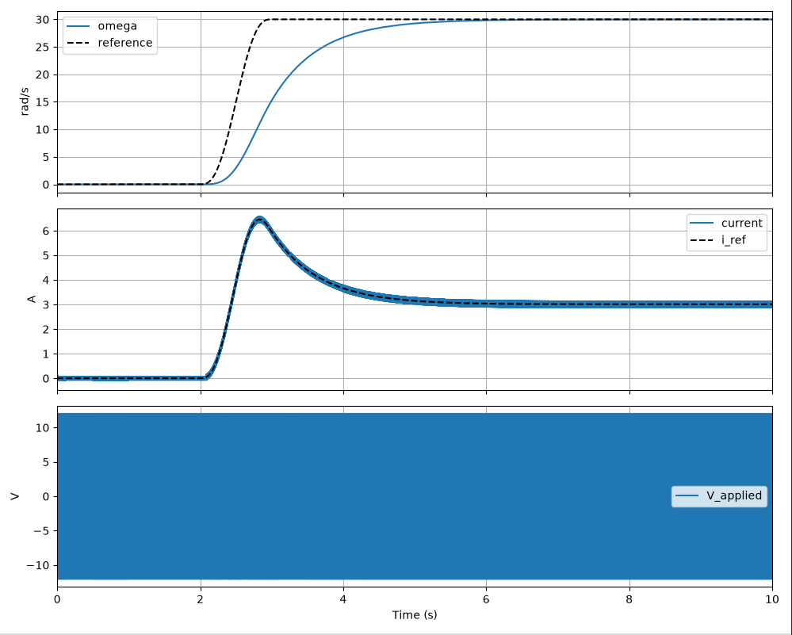
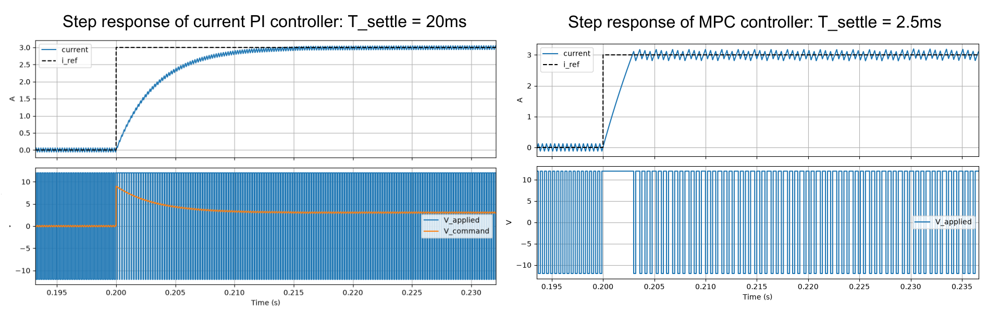
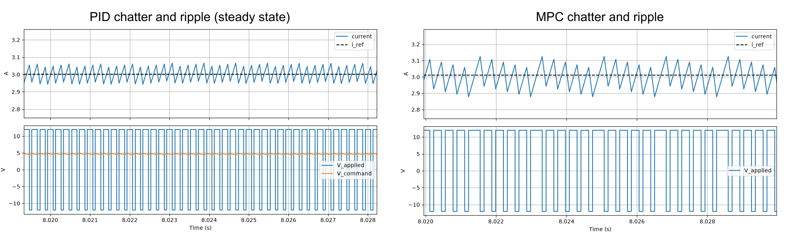
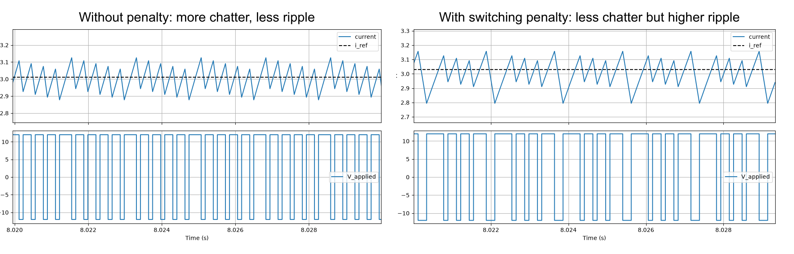

# DC Motor Drive: PID vs FCS-MPC Comparison

## 1. Overview
This simulation compares the performance of a PID cascade against a PID/FCS-MPC cascade driving a DC motor.
The outer loop outputs a current setpoint based on the speed error and is identical for both controllers (Pole cancellation tuned PI).

## 2. Baseline PID performance

First, PID cascade was tested to establish a baseline. The PID loops were tuned with pole cancellation method, and the speed setpoint is an s-curve. 

We can see that the motor current follows the trajectory generated by the outer controller with minimal lag.
The speed lag is due to conservative pole placement/bandwidth, and can be improved independantly of current loop.

## 3. Cascaded FCS-MPC 

Next, the FCS-MPC controller was built. The controller switches the output between 2 discrete voltages: {-Vdc, Vdc}, with the aim of minimising the motor current error. 

THe FCS MPC controller successfully controls the motor current by modulating the voltage, which allows the motor to reach the desired speed. 
However, we can see significant current ripple that wasn't present for the PID cascade. This is because the MPC controller is switching a H-Bridge, while the PID cascade is feeding the motor an ideal analog voltage source.

## 3. Switching PID

To make the comparison fair, a PWM modulator was implemented after PID cascade. The PWM modulator follows the principle of carrier wave PWM, and has a modulating frequency of 5 kHz. The MPC runs at 10 kHz. Below is the plot of the PID cascade response with PWM switching included in the model. 

 

Now that both models include switching dynamics, we can compare the 2 controllers with a step response of 3A:

 

We can see that the current tracking performance, as well as the response time of the MPC controller is superior to the PID. Of course, the PID could be tuned more agressivally to increase settle time, but this would introduce overshoot or instability, while the MPC natively provides the optimal current response speed (ie limited by motor resistance).

However, the trade-offs for this better transient performance are : higher current rippling compared to PID (0.2A vs 0.1A pk-pk ), which increases torque ripple as well as higher chatter at steady state, which increases switching losses and wear. 

One solution to help reduce chatter is introducing a switching penalty, that can be modelled by: switching cost = K * (delta_V/(2*V_max)**2.

Adding the penalty has successfully reduced the number of switching episodes, both during transients and steady-state, but this solution once again increases current rippling, now at 0.35A pk-pk, which causes undesirable torque jitter down the mechanical chain. 

## 4. Computational performance:

As mentionned before, increasing N exponentially increases the number of operations. To reduce the execution time, we can stop calculating the sequences that are already more expense then the current best, since the cost can only increase. For my tested N=4, this didn't result in a performance increase, the gains should be apparent on larger sequence sizes.

## 5. Axis of improvements:

First, increasing the switching frequency of both th PID and the MPC controllers could yield better current rippling performance, but this requires increasing the simulation frequency, which increases simulation times. 
Moreover the chosen horizon for the MPC controller (4 steps) corresponds to a lookahead time of only 0.4ms << L/R = 10ms. Increasing the number of prediction steps N could help the controller make wiser choices and reduce the amount of switching. 
However, the number of calculations increases exponentially with N. This makes the current loop based approach unsuitable for larger lookahead times, or real time execution. 
As a result, these operations should be parallelized in hardware or software to be able to run in real time.
